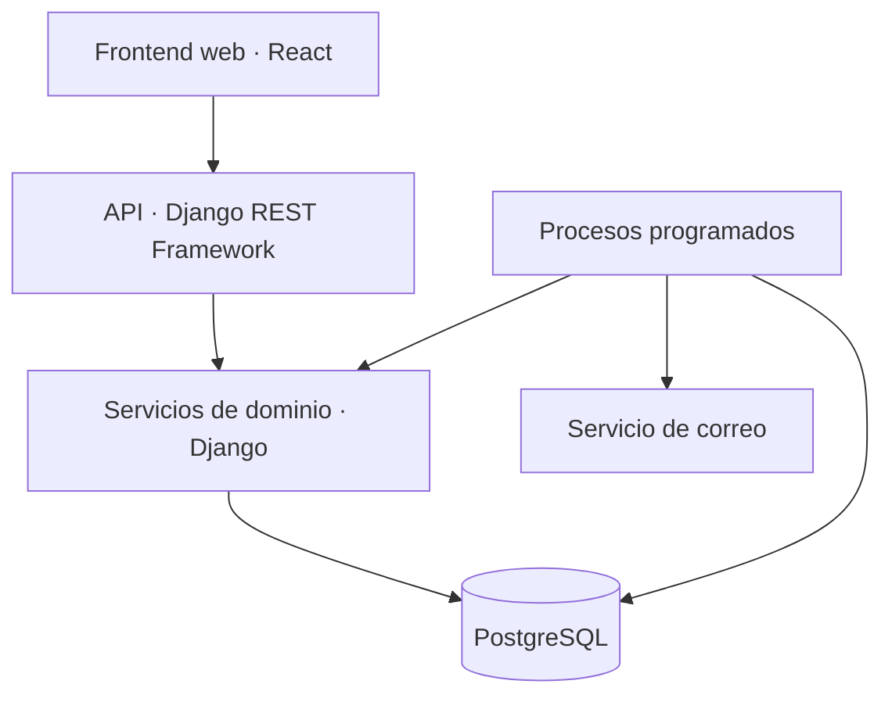

# Aerolínea Web

**Sistema de Gestión de Compra y Reserva de Tiquetes Aéreos en Línea**

Proyecto académico de **Laboratorio de Software**, del programa de **Ingeniería de Sistemas y Computación de la Universidad Tecnológica de Pereira**, desarrollado durante el periodo **2026-2** por un equipo de **cuatro integrantes**.

La aplicación busca gestionar el ciclo comercial del tiquete aéreo: programación de vuelos, consulta de disponibilidad, reserva, compra, administración de pagos internos y emisión del pasabordo. El caso de estudio corresponde a una aerolínea con operación nacional y expansión hacia rutas internacionales delimitadas.

> **Estado al 16 de octubre de 2026:** base técnica Django/PostgreSQL implementada y revisada localmente en la rama existente `BASE-01`, autorizada expresamente para esta tarea. Consulta [evidencias y límites](docs/BASE-01_VERIFICACION.md) y [ejecución del backend](backend/README.md). Las HU descritas siguen representando alcance previsto, no funcionalidades ya terminadas ni desplegadas.

Actualización local del **20 de octubre de 2026**, rama `HU-007`: núcleo backend de registro,
verificación y correo persistente implementado y probado. El alta pública está deshabilitada
en producción mientras falte una política aprobada. Reenvío, límites, imagen y comprobación por rango de Pwned Passwords ya están implementados. Consulta [alcance y evidencia de HU-007](docs/backend/HU-007.md);
frontend, integración y la historia completa siguen pendientes.

HU-008 añade el backend de login/logout, inactividad, bloqueo y recuperación de acceso.
Consulta [contratos, decisiones y evidencia](docs/backend/HU-008.md); la integración visual
y operativa se distingue de las verificaciones backend.

HU-009 incorpora creación y listado mínimo de administradores solo por ROOT, cambio de su
propia contraseña, auditoría y avisos persistentes. Consulta [contratos y evidencia de
HU-009](docs/backend/HU-009.md); frontend e integración operativa siguen pendientes.

## Contenido

- [Contexto y objetivos](#contexto-y-objetivos)
- [Alcance funcional](#alcance-funcional)
- [Actores y permisos](#actores-y-permisos)
- [Reglas principales del dominio](#reglas-principales-del-dominio)
- [Arquitectura](#arquitectura)
- [Stack tecnológico](#stack-tecnológico)
- [Equipo y responsabilidades](#equipo-y-responsabilidades)
- [Metodología y colaboración](#metodología-y-colaboración)
- [Documentación y decisiones](#documentación-y-decisiones)
- [Organización del repositorio](#organización-del-repositorio)
- [Preparación y ejecución](#preparación-y-ejecución)
- [Calidad y seguridad](#calidad-y-seguridad)
- [Decisiones pendientes](#decisiones-pendientes)
- [Evolución del proyecto](#evolución-del-proyecto)

## Contexto y objetivos

El proyecto aplica las fases del ciclo de vida del software a un problema de gestión comercial. Conforme al programa de la asignatura, articula análisis de requisitos, diseño de arquitectura, implementación, pruebas y gestión del trabajo en equipo.

El objetivo es construir una aplicación web **responsive**, con reglas de negocio verificables y trazabilidad entre requisitos, modelos, historias de usuario, código y pruebas.

Los objetivos específicos del producto son:

- Centralizar la oferta y disponibilidad de vuelos nacionales e internacionales.
- Permitir al cliente gestionar reservas, compras, cancelaciones e historial.
- Mantener consistencia entre cupos, sillas, tiquetes y saldo de la billetera.
- Facilitar el check-in y la entrega del pasabordo.
- Apoyar la comunicación mediante noticias, mensajería, recomendaciones y un chatbot.
- Ofrecer al equipo una base técnica reproducible y un proceso de integración revisado.

El contexto académico delimita el alcance. Los estándares de calidad se abordan mediante requisitos y evidencias verificables; no se presupone que el sistema esté certificado o preparado para una operación comercial real.

## Alcance funcional

La ERS organiza el sistema en nueve módulos. Los identificadores de historias corresponden al documento de HU y se conservan durante el desarrollo.

| Módulo | Capacidades previstas | Historias relacionadas |
|---|---|---|
| Administración de vuelos | Programación, edición, cancelación, cálculo de llegada, capacidad y promociones. | HU-001 a HU-004 |
| Búsqueda | Consulta, filtrado y catálogo de vuelos por ciudad. | HU-005 y HU-006 |
| Usuarios | Registro, verificación de correo, autenticación, recuperación de acceso y creación de administradores. | HU-007 a HU-009 |
| Gestión financiera | Medios de pago de prueba, billetera, depósitos, retiros y trazabilidad de movimientos. | HU-010 y HU-011; soporte a compra y cancelación |
| Compra y reserva | Viajeros, carrito, retención de cupos, compra, cancelación e historial. | HU-012 a HU-015 |
| Check-in y sillas | Confirmación de viaje, cambio de silla y emisión del pasabordo en PDF. | HU-016 y HU-017 |
| Noticias y comunicación | Noticias de vuelos y promociones, suscripciones y mensajería con administradores. | HU-018 y HU-019 |
| Recomendaciones | Sugerencias a partir del historial de búsquedas y compras. | HU-020 |
| Chatbot | Orientación sobre búsqueda y compra, con acceso a los flujos del sistema. | HU-021 |

### Límites de la versión académica

- Solo se contemplan vuelos directos, sin escalas ni conexiones.
- Los pagos se representan mediante una billetera y operaciones internas simuladas. No se integran bancos ni pasarelas reales.
- Se utiliza una moneda común para el sistema; no se implementan conversiones ni multimoneda. El valor de configuración se fija de manera compartida.
- Se excluyen gestión de flota, tripulación, mantenimiento aeronáutico y control aeroportuario.
- No se integran centrales externas de reservas, sistemas contables corporativos ni servicios operativos de aerolíneas.
- Aplicaciones móviles nativas, soporte multilingüe, reportes gerenciales avanzados y recomendaciones mediante aprendizaje automático quedan fuera de esta versión.
- El chatbot orienta al usuario. Las operaciones que afectan dinero, cupos y tiquetes se validan y confirman en los servicios del sistema.

## Actores y permisos

| Actor | Responsabilidad y acceso |
|---|---|
| Visitante | Consulta vuelos y utiliza el chatbot. Debe registrarse como cliente para reservar o comprar. |
| Cliente | Gestiona su perfil, reservas, compras, billetera e historial; accede a las funciones habilitadas conforme a verificación, propiedad y plazos. |
| Viajero | Persona asociada a un tiquete. Puede ser diferente del comprador y no necesita una cuenta para participar en el viaje. Su acceso rápido al check-in requiere la verificación que se acuerde. |
| Administrador | Gestiona vuelos y promociones y atiende la mensajería. No reserva ni compra con ese rol. |
| Root | Cuenta inicial responsable de crear administradores. No reserva ni compra con ese rol. |

`ROOT`, `ADMINISTRADOR` y `CLIENTE` son roles de cuenta. Visitante es la condición no autenticada; viajero es una entidad del dominio, no un rol que deba confundirse con cliente.

Los permisos se verifican en backend. Conocer un identificador o localizador no concede acceso a recursos ajenos. El rol root del negocio se distingue de los privilegios técnicos `is_staff` e `is_superuser` de Django.

## Reglas principales del dominio

Este resumen facilita la lectura del proyecto. Los límites exactos, excepciones y escenarios se desarrollan en el [complemento de aclaraciones](docs/ACLARACIONES_Y_LINEAMIENTOS_DEL_PROYECTO.md).

### Vuelos y rutas

Las rutas nacionales se limitan al catálogo acordado de capitales principales de Colombia. Para las internacionales se contemplan estos conjuntos:

| Orígenes autorizados | Destinos autorizados |
|---|---|
| Pereira, Bogotá, Medellín, Cali y Cartagena | Madrid, Londres, Nueva York, Buenos Aires y Miami |

La admisión de rutas internacionales inversas para ida y regreso está pendiente de aclaración. No se amplía el catálogo por inferencia.

| Tipo de vuelo | Capacidad total | Primera clase | Clase económica |
|---|---:|---|---|
| Nacional | 150 | Sillas 1–25 | Sillas 26–150 |
| Internacional | 250 | Sillas 1–50 | Sillas 51–250 |

La duración procede del catálogo de rutas. La llegada se calcula a partir de la salida y la duración, mostrando la hora local del destino. Los instantes se gestionan con zona horaria y las ciudades utilizan identificadores IANA.

### Identificación, reservas y compra

- El ID interno y el código visible del vuelo son distintos. El código comercial utiliza un prefijo configurable y un consecutivo autogenerado, por ejemplo `XX0001`; es único e inmutable dentro del proyecto.
- Una compra confirmada tiene un localizador compartido de seis caracteres. Cada combinación de viajero y vuelo conserva un tiquete individual.
- El comprador puede adquirir tiquetes para otras personas. Se permiten como máximo cinco participaciones activas por cliente y vuelo, sumando reservas vigentes y compras activas.
- Un viajero no puede aparecer dos veces de forma activa en el mismo vuelo. Cada grupo de viajeros por operación y vuelo debe incluir al menos un adulto.
- La reserva vence al primero de estos límites: 24 horas desde su creación o el corte previo a la salida —una hora en nacionales y tres en internacionales—.
- Una reserva retiene cupos de la clase; la silla numerada se asigna inicialmente al comprar. Convertir una reserva en compra no descuenta dos veces el inventario.
- Una reserva sin pago no congela automáticamente la tarifa. El cliente debe aceptar el precio vigente antes del débito.

### Billetera, cambios y check-in

- La billetera se crea junto con la cuenta y no tiene un campo `creada_en` independiente. Los movimientos sí tienen fecha y trazabilidad propias.
- Saldo y valores monetarios se manejan con decimales. Compras, débitos, liberaciones y reembolsos requieren consistencia transaccional y protección frente a reintentos.
- El reembolso corresponde a la billetera del comprador que pagó. Cancelar una reserva sin pago no produce un abono.
- El administrador puede reprogramar fecha y hora y modificar la tarifa base de un vuelo pendiente aunque existan tiquetes vendidos. Esta aclaración amplía la restricción del enunciado original y debe conservar su trazabilidad.
- Los cambios de tarifa afectan futuras compras. Los tiquetes confirmados conservan su precio pagado. Una promoción es un descuento temporal con condiciones; no se confunde con un cambio permanente de tarifa.
- El check-in se habilita durante las 24 horas previas a la salida vigente. Cada tiquete permite un cambio voluntario de silla dentro de su clase antes de confirmar check-in; después no se permite ese cambio.
- Los vuelos y operaciones cancelados se conservan como historial. La transición a vuelo realizado y determinados efectos de reprogramación o reubicación requieren las decisiones pendientes documentadas.

## Arquitectura

Se adopta un **monolito modular**: una aplicación backend con módulos por dominio y una base de datos PostgreSQL común. El frontend consume una API HTTP; no accede directamente a la base de datos.

Esta organización permite coordinar en una transacción las operaciones que afectan inventario, tiquetes y dinero, y mantener un despliegue adecuado al tamaño del equipo.

El siguiente esquema representa la arquitectura prevista, no servicios ya desplegados:



Los procesos programados utilizan el mismo backend y las mismas reglas para vencimientos y notificaciones. El esquema no presupone microservicios ni una cola distribuida.

| Componente | Responsabilidad |
|---|---|
| Modelos | Relaciones, persistencia y restricciones de datos. |
| Serializers | Contratos de entrada/salida y validación de representación. |
| Servicios de dominio | Reglas, casos de uso, transacciones y coordinación entre módulos. |
| Vistas y permisos | Adaptación HTTP, autenticación y autorización por rol y propiedad. |
| Procesos programados | Ejecución repetible de vencimientos y recuperación de trabajo pendiente. |
| Pruebas | Comportamientos esperados, errores, integración y concurrencia. |

El esquema de base de datos evoluciona mediante migraciones versionadas. El usuario personalizado se define antes de la primera migración de autenticación. Los diagramas orientan el diseño y se actualizan cuando una decisión documentada modifica el modelo.

Los correos se procesan después de confirmar la operación de negocio, con intención de envío persistida y reintentos. Una falla de correo no debe deshacer una compra confirmada.

## Stack tecnológico

La tabla describe la base acordada y las herramientas propuestas para concretarla. La incorporación de cada componente debe quedar reflejada en archivos de configuración y dependencias versionadas.

| Área | Tecnología | Función o estado |
|---|---|---|
| Backend | Python, Django y Django REST Framework | Aplicación, ORM, autenticación y API. |
| Base de datos | PostgreSQL | Persistencia relacional y operaciones transaccionales. |
| Frontend | React, TypeScript y Vite | Interfaz web y herramientas de desarrollo. |
| Componentes de interfaz | Material UI | Biblioteca propuesta para la interfaz responsive. |
| Contrato API | OpenAPI y drf-spectacular | Esquema generado y documentación navegable. |
| Autenticación | Sesiones de Django y CSRF | Sesiones compartidas en base de datos y protección de operaciones. |
| Contraseñas | Argon2 mediante Django | Hash de contraseñas; sin algoritmos propios. |
| Pruebas | pytest, pytest-django y pytest-cov | Pruebas automatizadas y cobertura. |
| Calidad estática | Ruff | Análisis estático y formato propuestos para BASE-01. |
| Dependencias Python | pip-tools y requirements | Dependencias declaradas y versiones resueltas. |
| Entorno | Docker y Docker Compose | Ejecución reproducible; WSL para el trabajo en Windows. |
| Integración continua | GitHub Actions | Comprobaciones en cambios y PR. |
| Despliegue | AWS EC2, Nginx y Gunicorn | Destino previsto; infraestructura aún por implementar y validar. |
| Base en despliegue | PostgreSQL persistente; RDS como alternativa | La opción definitiva corresponde a integración. |
| Correo y documentos | SMTP; ReportLab como herramienta propuesta | Notificaciones y pasabordos PDF. |

BASE-01 se verificó con **Python 3.13.16, Django 5.2.18 (LTS) y PostgreSQL 17.11**. Las dependencias Python están fijadas con hashes en `backend/requirements/`; la guía del backend registra las demás versiones y las diferencias entre desarrollo, pruebas y producción.

Las dependencias Python pertenecen a `backend/`; las del frontend se gestionan mediante `package.json` y su archivo de bloqueo. El equipo debe instalar las versiones fijadas, sin resolver una combinación distinta en cada máquina.

## Equipo y responsabilidades

El equipo está integrado por **cuatro personas**. Los roles de desarrollo son independientes de los roles de usuario del sistema.

| Rol del equipo | Cantidad | Responsabilidades |
|---|---:|---|
| Backend | 2 | Modelos, migraciones, API, reglas de negocio, transacciones, seguridad y pruebas del backend. Victor es uno de sus integrantes. |
| Frontend | 1 | Interfaz responsive, accesibilidad, formularios, navegación e integración con el contrato API. |
| Integración y despliegue | 1 | Entornos, contenedores, CI, configuración de infraestructura, despliegue, observabilidad y copias de seguridad. |

La revisión de requisitos, decisiones, pruebas e integración es una responsabilidad compartida. El reparto nominal de HU se registra en el tablero o mecanismo de seguimiento del equipo; este README no asigna módulos individuales que todavía no estén acordados.

Cada cambio debe tener un autor principal y una revisión de otra persona. Los cambios compartidos en usuario, billetera, inventario y migraciones requieren coordinación entre ambos integrantes de backend y, cuando corresponda, integración.

## Metodología y colaboración

El trabajo sigue un enfoque **iterativo e incremental**, organizado en paquetes de historias relacionadas y entregas verificables. No se presupone un marco Scrum formal ni ceremonias o roles que el equipo no haya establecido.

Un paquete sirve para planificar una capacidad o conjunto de dependencias. Según las [reglas de trabajo](REGLASCOMMITS.md), cada HU mantiene su propia rama y pull request.

### Flujo de una historia

1. Revisar requisitos, HU, caso de uso, modelos y aclaraciones aplicables.
2. Identificar dependencias y pendientes antes de implementar.
3. Crear una rama desde `main`, siguiendo el patrón `feat/HU-N-descripcion`.
4. Implementar el alcance de la historia con sus validaciones, migraciones y pruebas.
5. Actualizar el contrato API y la documentación afectada.
6. Abrir un PR con trazabilidad, resultados de validación y pendientes explícitos.
7. Obtener al menos una aprobación de otra persona, integrar mediante **Squash and merge** y eliminar la rama.

Se permiten commits de tipo `feat`, `fix`, `docs`, `test` y `chore`. No se realizan pushes directos a `main`, `git push --force` ni commits con secretos.

La numeración de las HU procede de su documento: **HU-005 corresponde a búsqueda y HU-012 a reserva**. Los ejemplos de comandos no redefinen esos identificadores.

**BASE-01** identifica la tarea de preparación técnica inicial; no es una HU ficticia. El encargo original indicaba `configuracion_entorno`, pero el 16 de octubre de 2026 el usuario autorizó continuar en la rama existente **`BASE-01`**. Esta excepción no define una convención general ni cierra P-07. No se crearon ramas, commits ni PR durante la revisión.

### Uso de herramientas de IA

Todas las herramientas utilizadas deben consultar las mismas fuentes del repositorio. Los acuerdos de un chat individual solo forman parte de la base compartida cuando se registran en la documentación correspondiente.

- Consultar el complemento de aclaraciones y las instrucciones `AGENTS.md` aplicables.
- Inspeccionar el código y las migraciones antes de proponer cambios.
- No inventar funcionalidades, parámetros de negocio ni aprobaciones.
- Resolver las partes independientes cuando un pendiente bloquee una función concreta.
- Mantener revisión humana del diff y de las pruebas antes de integrar.
- No declarar verificaciones que no se hayan ejecutado.

## Documentación y decisiones

El README ofrece una vista general. La especificación detallada se consulta en [docs/](docs/).

| Documento de referencia | Propósito |
|---|---|
| `Proyecto_Lab_Soft_2026-02.pdf` | Enunciado y alcance original solicitado. |
| `ERS(1).pdf` | Requisitos funcionales y no funcionales, restricciones y reglas. |
| `Diagramas de Clases.pdf` | Modelo de dominio y responsabilidades. |
| `er.pdf` | Modelo de datos de referencia. |
| `Historias_Usuario_Sistema_Tiquetes_Aereos.pdf` | Historias y criterios de aceptación. |
| `Acta_Casos_de_Uso_Tiquetes_Aereos.docx` | Actores, precondiciones y flujos. |
| `Mockups · Sistema de Tiquetes Aéreos.html` | Referencia visual y navegación. |
| `is714-laboratorio-de-software(1).pdf` | Contexto, objetivos y competencias de la asignatura. |
| `ACLARACIONES_Y_LINEAMIENTOS_DEL_PROYECTO.md` | Correcciones, decisiones comunes, trazabilidad y pendientes. |
| `REGLASCOMMITS.md`, en la raíz | Convenciones de colaboración mediante Git. |

Los nombres anteriores identifican los documentos de origen. Su ubicación interna debe mantenerse coherente con la organización de `docs/`.

Las decisiones resueltas del [complemento](docs/ACLARACIONES_Y_LINEAMIENTOS_DEL_PROYECTO.md) prevalecen sobre los fragmentos originales que corrigen expresamente. Para los demás puntos, siguen vigentes el enunciado y los requisitos aplicables. Las ampliaciones frente al enunciado conservan su identificación y la validación académica que corresponda.

Este README no resuelve nuevos conflictos ni sustituye los criterios de aceptación. Una diferencia no documentada debe registrarse antes de convertirse en una regla de implementación.

## Organización del repositorio

| Ruta | Contenido previsto |
|---|---|
| `backend/` | Proyecto Django, módulos, migraciones, dependencias y pruebas. |
| `frontend/` | Aplicación React, componentes y consumo de API. |
| `docs/` | Documentación del proyecto, modelos y aclaraciones. |
| `.github/` | Plantillas y automatizaciones de integración. |
| `README.md` | Contexto general y orientación de entrada. |
| `REGLASCOMMITS.md` | Reglas de ramas, commits y PR. |

La base incluye `AGENTS.md`, Compose de desarrollo y su opción para WSL, `.env.example`, Dockerfile con stages separados, usuario personalizado y billetera mínima, dependencias fijadas, pruebas, contrato API, CI y plantilla de PR reconocida por GitHub. [La revisión](docs/BASE-01_VERIFICACION.md) distingue lo implementado de lo validado.

## Preparación y ejecución

BASE-01 incorpora la configuración inicial Django/PostgreSQL, Compose, dependencias, CI y
contrato OpenAPI. La configuración y los comandos se documentan en [backend/README.md](backend/README.md).
Compose y las verificaciones locales se ejecutaron; GitHub Actions todavía no se ha ejecutado en GitHub.

Para obtener una copia nueva del repositorio:

```bash
git clone https://github.com/Esteban8482/Aerolinea-Web.git
cd Aerolinea-Web
git status
```

Quien ya tenga el clon debe trabajar dentro de esa raíz y conservar su rama y entorno existentes. No debe inicializar otro repositorio alrededor del clon.

La preparación debe seguir este orden:

1. Leer la documentación y comprobar la rama, los cambios locales y las versiones fijadas.
2. Conservar el `.env` local existente; para un clon nuevo, generar valores con la guía del backend. `.env.example` contiene secretos vacíos y no sirve directamente para arrancar.
3. Iniciar PostgreSQL y Django con `docker compose up --build -d --wait`.
4. Aplicar migraciones con `docker compose exec backend python manage.py migrate --noinput`.
5. Crear root solo cuando se necesite, interactivamente: `docker compose exec backend python manage.py create_root --root-id root`.
6. Abrir `http://localhost:8000/api/docs/` y ejecutar las comprobaciones de [backend/README.md](backend/README.md).

Los comandos de Compose se ejecutan desde la raíz del repositorio en WSL/Linux con Docker
Compose y su integración disponibles. Los entornos de desarrollo, pruebas y producción
mantienen configuración separada; no se utiliza una base productiva para ejecutar pruebas.

## Calidad y seguridad

La ERS establece objetivos que deben demostrarse con pruebas, mediciones y evidencia. No se consideran cumplidos por la elección de un framework o proveedor de infraestructura.

| Aspecto | Criterio de referencia |
|---|---|
| Consistencia | Operaciones críticas atómicas, restricciones de base de datos y control de concurrencia. |
| Reintentos | Prevención de compras, débitos, reembolsos y liberaciones duplicados. |
| Autorización | Roles, propiedad de recursos y verificación de correo según la operación. |
| Credenciales y sesiones | Hash seguro, CSRF, configuración segura de cookies, cierre de sesión e inactividad. |
| Trazabilidad | Relación HU/CU/RF/RNF → decisión → componente → prueba; auditoría sin secretos. |
| Pruebas | Cobertura mínima del 70 % sobre lógica de negocio, conforme a la ERS. |
| Accesibilidad | Diseño responsive y criterios WCAG 2.1 AA. |
| Recuperación | Copias diarias y RPO de hasta 24 horas, con restauración comprobada. |
| Disponibilidad | Objetivo mensual del 99 %, sujeto a infraestructura y medición. |
| Rendimiento | Referencias iniciales: búsqueda p95 ≤ 3 s, detalle/catálogo p95 ≤ 2 s y compra ≤ 5 s sin entrega de correo. |

La carga nominal y el entorno de medición deben acordarse antes de afirmar cumplimiento de rendimiento. Las pruebas de integración y concurrencia utilizan PostgreSQL para representar los mecanismos del sistema.

Una HU se considera terminada cuando cumple sus criterios, tiene verificaciones ejecutadas, migraciones y contrato actualizados, integración pertinente comprobada y revisión de otra persona. La existencia aislada de un endpoint o una pantalla no basta.

## Decisiones pendientes

El registro detallado y vigente se mantiene en el complemento. Al preparar esta versión del README, permanecen los siguientes grupos:

| ID | Tema por resolver |
|---|---|
| P-01 | Transición a vuelo realizado; retrasos, reprogramaciones, reubicación y efectos sobre check-in y pasabordos. |
| P-03 | Verificación del viajero para check-in rápido sin cuenta. |
| P-04 | Cupos de promociones, superposición, reservas anteriores y entrada de tarifas por clase. |
| P-05 (parcial) | Siguen pendientes otros parámetros de seguridad, finanzas e imágenes. DEC-16/17 resuelven registro/reenvío, imagen y consulta por rango de HU-007; DEC-18/19/20 concretan login, recuperación e inactividad de HU-008; DEC-21/22 fijan límites de alta de administradores y cambio propio de contraseña ROOT en HU-009. No cierran P-05 globalmente. |
| P-06 | Rutas internacionales de regreso frente a la restricción de origen y destino. |
| P-07 | Convención general de ramas y PR para tareas técnicas sin HU. |

Un pendiente bloquea el comportamiento afectado, no todo el desarrollo. Su cierre debe registrar decisión, responsable del acuerdo, fecha, artefactos afectados y validación. Las propuestas de resolución no se consideran aprobaciones implícitas.

**P-02 quedó resuelta el 16 de octubre de 2026** para la base del usuario: root accede por ID,
con correo opcional y sin datos personales obligatorios; clientes y administradores acceden
por correo único sin distinguir mayúsculas. La cuenta root de negocio no implica privilegios
de Django. La decisión no adelanta permisos financieros ni sustituye las reglas de cada HU.

## Evolución del proyecto

**BASE-01** deja la configuración técnica preparada y verificada localmente. Su [reporte](docs/BASE-01_VERIFICACION.md) conserva evidencia, cambios respecto de la primera implementación y verificaciones externas pendientes. No acredita un despliegue ni el cumplimiento de las HU.

Después, el desarrollo avanza por paquetes de HU con dependencias explícitas. Autenticación y permisos habilitan las operaciones protegidas; vuelos e inventario soportan búsqueda y ventas; billetera participa en compras y reembolsos; check-in consume tiquetes confirmados.

Las dependencias cruzadas deben verificarse antes de cerrar una historia. Por ejemplo, cancelar un vuelo con ventas requiere el tratamiento financiero y de afectaciones correspondiente, aunque su numeración aparezca antes que las historias de compra.

El avance real se registra en el seguimiento del equipo y en los PR. Este README debe actualizarse cuando cambien el alcance, los acuerdos, la estructura o los comandos de ejecución, conservando la documentación detallada como fuente de las reglas del negocio.
